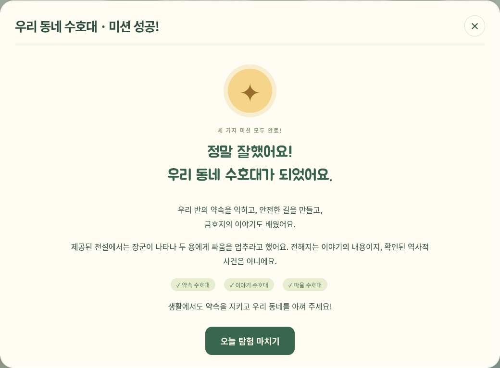
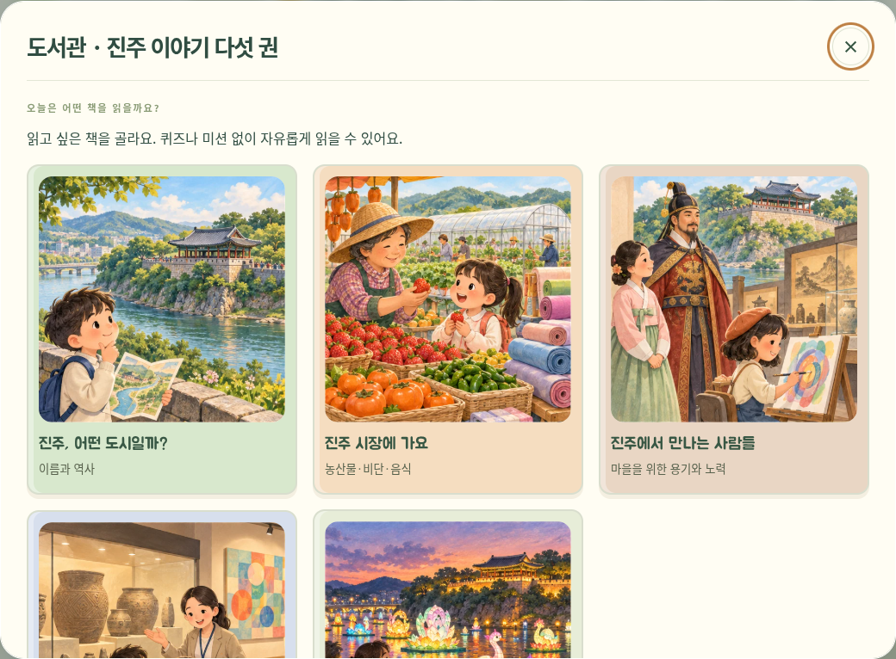

# 금산마을 탐험대 🌱

초등학교 4학년을 위한 Three.js 3D 교육 게임입니다. **학급 규칙 → 안전한 통학로 → 금호지 전설**의 세 미션을 마치면 우리 동네 수호대가 됩니다. 도서관은 미션과 관계없이 진주 이야기 다섯 권을 읽는 공간입니다.

[설치 없이 플레이](https://rkdrkals0227.github.io/Idea-prj-_ver1/) · [실시한 검증](docs/VALIDATION.md)



금산면의 장소 이름을 모티브로 만든 수업용 축약 마을입니다. 실제 길 안내가 아니며, 가상의 주민은 동물의 실제 서식 증거가 아닙니다. 학급 규칙은 9월 학급 회의에서 4-4반 아이들이 정한 약속입니다.

## 실행과 배포

이용자는 위 링크를 브라우저로 열면 됩니다. 개발자는 Node.js22.12 이상과 npm을 사용합니다.

```sh
cd Idea-prj-_ver1
npm ci
npm run dev -- --port 5173
```

```sh
npm run build
npm run preview -- --port 4173
```

`index.html` 파일 더블클릭 실행은 지원하지 않습니다. 기본 게임에는 API 키·로그인·유료 서비스가 필요 없습니다. 모델·그림·글꼴은 로컬 정적 자원이며 실행 중 외부 CDN에 의존하지 않습니다.

정적 호스팅은 `dist/` 전체를 올립니다. Vite `base:'./'`이므로 하위 경로도 지원합니다. 소스는 `main`, 빌드 결과는 `gh-pages`에 게시하며 두 브랜치를 서로 병합하지 않습니다. GitHub Pages는 Deploy from a branch → gh-pages → /(root) 설정을 사용합니다. 새 버전이 보이지 않으면 캐시를 새로고침하세요(Mac:⌘⇧R).

## 조작

- WASD/방향키: 걷기. E/화면 아래 버튼: 가까운 대상과 상호작용. 한글 입력 상태에서도 물리 키를 인식합니다.
- 학교와 도서관은 문 앞에서 E로 들어가고 실내 출구로 나옵니다. 게시판과 책장도 가까이에서 E로 살펴봅니다.
- 도서관 안의 큰 책5개는 마우스로 직접 클릭할 수도 있습니다.
- 대화·책·퀴즈·타이핑 중에는 이동을 멈춥니다. Esc/×로 닫습니다. 탐험을 마친 화면은 ‘다시 마을 둘러보기’로 돌아옵니다.
- ‘탐험 도구’에는 마을 지도·가방·설정만 있습니다. 태블릿은 방향 버튼과 상호작용 버튼을 사용합니다.

현재 미션만 왼쪽에 표시하고 목적지를 빛으로 안내합니다. 약1분의 전경 활동 시간마다 어디서 무엇을 할지 안내하며, 편집·대화 중과 성공 뒤에는 안내를 멈춥니다. 시간대는 한국 실제 시각에 맞추고, 활동 시간은 창을 보고 있는 동안에만 누적합니다.

## 세 미션과 마무리

1. **학교 — 우리 반 약속:** 칠판의 네 규칙 바로 아래에 타자로 따라 씁니다. 앞 번호·띄어쓰기·문장부호 차이는 허용하고 의미 있는 글자와 숫자는 확인합니다. 한글 조합 확정 후 판정하며 네 줄을 맞히면 즉시 완료합니다.
2. **통학로 — 설명을 먼저 읽기:** 점자블록의 목적, 선형/점형의 역할, 통행로를 비워 두는 약속을 세 장으로 읽습니다. 순서대로 확인하기 전에는 길 수리·쓰레기 수거·분리배출을 시작할 수 없습니다. 도중 닫아도 읽은 페이지가 저장됩니다. 이미 끝낸 이전 통학로 기록을 다시 잠그지는 않습니다. 설명을 읽은 뒤의 **통학로 활동**은 상자 치우기 → 같은 무늬 고르기 → 화살표와 나란한 방향 고르기. 두 그림 중에서 고르고 오답은 힌트 뒤 재시도합니다. 설정된 전체 경로를 검증하고 실제 학교~아파트38블록의 파손 상태를 바꿉니다. 아파트 길의 쓰레기 세 개를 주우면 분리배출 화면이 자동으로 열리고, 모두 올바르게 분류하면 통학로 미션이 끝납니다. 실제 시설 수리는 담당 기관이 맡는다는 안내를 포함합니다.
3. **금호지 — 세 번째이자 마지막 미션:** 호수를 클릭하거나 가까이에서 E키로 동화책을 엽니다. 청룡·황룡의 전설 여섯 장을 끝까지 읽고 퀴즈를 맞힙니다. 틀려도 다시 풀 수 있습니다.

규칙·통학로·이야기 스탬프3개를 모으면 **‘정말 잘했어요! 우리 동네 수호대가 되었어요.’**라는 성공 화면이 즉시 나옵니다. ‘오늘 탐험 마치기’를 누르면 이동과 활동 시간을 멈추고 저장합니다. 새로고침해도 완료 상태가 유지되며 창을 닫아도 됩니다. 다시 둘러보기·책 읽기는 선택 사항입니다. **4단계·그림 등록·생태 지도 전시 미션은 제거했습니다.**

점자블록과 전설의 읽은 페이지, 쓰레기 ID와 분류, 퀴즈 정답은 중복 클릭으로 보상이나 진행이 늘어나지 않습니다. 남생이 대화의 호수 돌봄은 별도의 자유 체험으로 남아 있으며 게임 종료 조건은 아닙니다.

## 도서관 · 진주 이야기 다섯 권



- **진주, 어떤 도시일까?** — 이름과 역사, 남강과 옛 도시.
- **진주 시장에 가요** — 농산물·비단·음식.
- **진주에서 만나는 사람들** — 김시민·논개·유계춘·이성자·지역 기업가의 이야기.
- **박물관과 미술관 나들이** — 국립진주박물관·진주시립이성자미술관·진주청동기문화박물관.
- **남강에 불빛이 반짝!** — 진주남강유등축제와 안전한 관람.

각 책은 장면별 창작 삽화, 초등4학년 수준의 짧은 문장, ‘함께 생각해 봐요’ 상황으로 구성합니다. 책 선택·앞/뒤쪽·다른 책 선택을 제공하고 읽은 내용을 저장합니다. 퀴즈·과제·책 완독 보상·레벨 제한은 없습니다. 사서 학에게 말을 걸어도 책장을 엽니다.

`src/data/library-books.js`에서 제목·본문·상황·참고 링크를 수정합니다. 제공 자료를 재구성한 수업용 자료이며 **공식 원문 검증 완료로 표시하지 않습니다.** 환경 프록시가 진주시·박물관·축제 사이트 요청을403으로 막아 `checkedAt:null`을 유지합니다. 백낙신을 농민항쟁 지도자로 소개하거나 강주룡을 진주 출신으로 소개한 부분은 제외했습니다. 미술관 기관명 혼합, 미확인 이전/시설 현황, 생산 비율·연대·병력·행사 편성·지명 유래 단정도 제외했습니다. 교사용 검토 메모는 같은 파일의 `libraryReviewNotes`에 있습니다.

`public/illustrations/jinju-books.webp`는3열×2행 삽화 묶음이며 처음5장면을 사용합니다. 그림은 역사 현장·전시물의 정확한 재현 사진이 아닙니다. 전설은 별도 `geumho-story.webp` 여섯 장면을 사용하고 설화라는 안내를 유지합니다. 글꼴은 로컬 Jua WOFF와 SIL OFL 라이선스를 포함합니다. 삽화 실패 시 대체 그림, 글꼴 실패 시 기본 글꼴로 읽습니다.

## 교사용 자료와 모델 연결

설정 → 교사용 수업 편집에서 학급 규칙·회의 안건·주민 대사·기존 주제별 퀴즈·금호지 전설·미션 목표를 JSON으로 편집하거나 가져오기/내보내기 할 수 있습니다. 도서관 책은 위 데이터 파일에서 편집합니다. 로컬 교사용 메뉴 구분은 서버 계정 권한 보호가 아닙니다.

`src/data/asset-manifest.json`에서 역할 ID, GLB 경로, 위치·회전·크기·충돌·애니메이션 연결을 관리합니다. 업로드 모델과 원래 파일명 대응은 `public/models/uploaded/provenance.json`에 있습니다. 새 GLB/glTF와 상대 텍스처/버퍼를 `public/models/` 아래에 넣고 역할의 경로를 바꾸세요. Three.js/GLTFLoader는 같은 고정 버전0.180.0을 사용합니다. 크기·바닥·방향을 바운딩 박스로 맞추고 실패한 대상만 기본 도형으로 대체합니다.

주민은 수달·남생이·학 한 마리씩 실제 경로를 걷고 가까이 오면 멈춥니다. 건물과 호수·나무·소품에는 충돌이 있습니다. 학교·도서관·아파트·금호지와 업로드된 배경 소품을 사용하고, 실제 학교 이름은 교사 설정으로 바꿀 수 있습니다.

## 우체통 · 우리 동네에 의견 전하기

우체통은 어느 레벨에서나 열어 진주시 누리집 링크와 어린이용 안내를 볼 수 있습니다. 불편한 곳과 바뀌면 좋을 점을 차근차근 적고 선생님·보호자와 확인하도록 안내합니다. [진주시 의견 남기기 페이지](https://www.jinju.go.kr/00132/00379/00393.web)는 새 탭으로 열립니다. 게임은 실제 기관에 글을 자동 제출하지 않습니다. 별도의 게임 속 편지 연습·저장·접수는 기존처럼 레벨3부터 사용합니다.

## 저장과 이전 버전 자료

진행·편지·소감·읽은 페이지·설정·교사 자료는 localStorage에 보관합니다. 이전 작품 Blob과 정보는 IndexedDB(`geumsan-art-v1`)에 그대로 남깁니다. 현재 마을이나 지도에 전시하지 않고 게임 완료에 영향을 주지 않습니다. 교사 편집의 ‘이전 작품 보관함’에서 확인·내보내기가 가능하며 개인 기록 백업/복원에도 포함합니다.

저장 실패에는 복구 안내와 내보내기를 제공합니다. 진행은 브라우저·사이트 주소별이므로 다른 기기나 개발/배포 주소에 자동 공유되지 않습니다. 시크릿 모드 종료·사이트 데이터 삭제 전에는 백업하세요. 학급 서버 공유·교사 인증·실시간 멀티플레이는 미연결이며 [확장 설계](docs/SHARING.md)를 참고합니다.

## 주요 파일과 검증

- `src/journey.js`, `guardian.js`: 세 레벨과 스탬프·완료 조건.
- `src/road-reading.js`, `road-intro.js`: 필수 점자블록 설명과 읽기 기록.
- `src/road-lesson.js`, `road-ui.js`: 쉬운 그림 문제와 수리 검증.
- `src/library.js`, `data/library-books.js`: 미션 없는 도서관5권.
- `src/main.js`: 화면·저장·활동·성공과 마치기 연결.
- `src/world.js`, `models.js`, `scenery.js`: 마을·모델·이동·충돌·낮밤.
- `src/storage.js`: 로컬 저장과 백업. 기존 이미지 처리 모듈은 알고리즘 자료로만 남아 있으며 현재 학생 업로드 UI는 없습니다.

```sh
npm test
npm run test:e2e
npm run build
```

브라우저 검사는 시스템 Chromium 또는 설치한 Playwright Chromium을 사용합니다. 현재 환경은 소프트웨어 WebGL이므로 복합 흐름에 시간이 더 걸립니다. 실제 검사 결과·범위·공개 사이트 직접 접속 제한은 [검증 기록](docs/VALIDATION.md)을 확인하세요.
