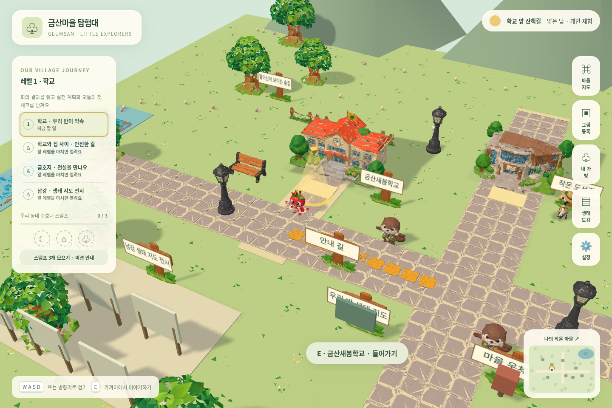
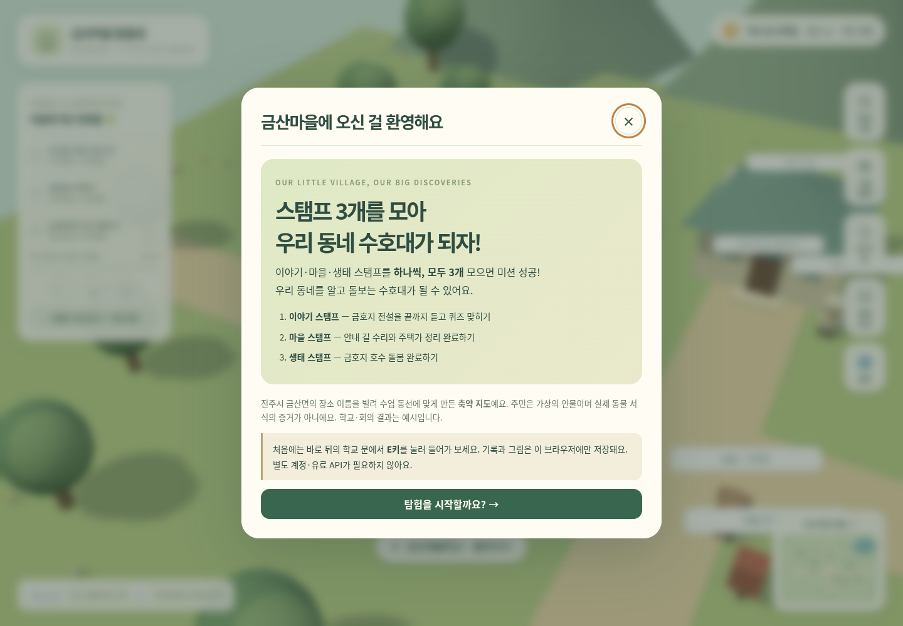
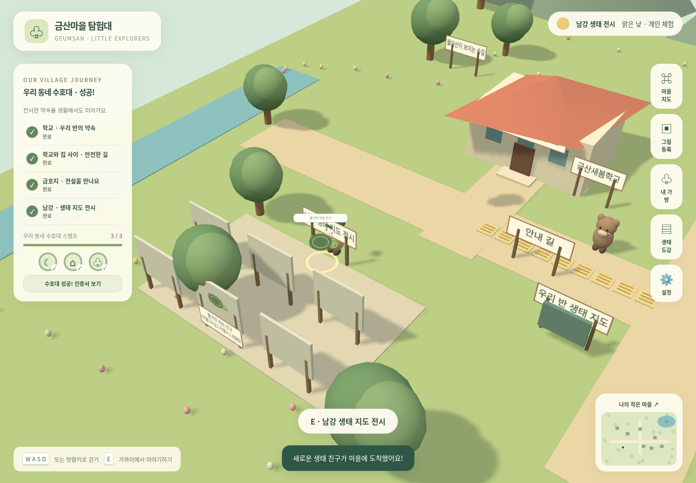

# 금산마을 탐험대 🌱

초등학교 4학년을 위한 브라우저 3D 사회·생태 교육 게임입니다. 주민의 이야기를 듣고, 공동체 문제를 해결하고, 직접 그린 생물을 마을에 등록합니다. 순위 대신 주민의 감사, 활동 배지, 마을 변화로 성취를 표현합니다.



금산면의 장소 이름을 모티브로 만든 수업용 축약 마을입니다. 실제 길 안내가 아니며, 학교·학급 회의·동물 주민은 예시입니다. 가상의 동물 주민이 실제 서식 증거를 의미하지 않습니다.

## 설치 없이 링크로 이용하기

브라우저 배포 파일은 이 저장소의 **gh-pages** 브랜치에 있습니다. 최초 한 번 저장소 소유자가 [GitHub Pages 설정](https://github.com/rkdrkals0227/Idea-prj-_ver1/settings/pages)에서 다음을 선택합니다.

1. **Source**: Deploy from a branch
2. **Branch**: gh-pages
3. **Folder**: /(root)
4. **Save**

설정 및 GitHub 배포 완료 후 주소: **https://rkdrkals0227.github.io/Idea-prj-_ver1/**

이용자는 파일 설치·Node.js·터미널 없이 링크만 엽니다. 작품과 진행은 기기/브라우저/사이트 주소별로 저장되며 자동 학급 공유는 아닙니다. 기존 로컬 주소의 작품은 작품 묶음 또는 개인 백업으로 옮깁니다.

배포 준비 시 정적 하위 경로 `/Idea-prj-_ver1/`에서 HTTP 200, WebGL 캔버스, 학교 입장, 브라우저 오류 0건을 확인했습니다. 현재 클라우드에서는 GitHub Pages 설정 API 및 공개 사이트 접속이 네트워크 정책으로 차단되어 활성화 설정과 인터넷 접속은 확인하지 못했습니다.

개발자는 main의 게임 코드를 바꾼 뒤 빌드 결과를 gh-pages에 다시 게시해야 공개 사이트가 갱신됩니다. 소스 코드는 main, 실행용 파일은 gh-pages로 분리하며 두 브랜치를 서로 병합하지 않습니다.

## 실행

Node.js 22.12 이상(현재 환경: 24.19.0), npm을 사용합니다.

```sh
cd /workspace/Idea-prj-_ver1
npm ci --cache /tmp/geumsan-npm-cache
npm run dev -- --port 5173
```

일반 PC에서는 저장소 폴더로 이동한 뒤 같은 npm 명령을 실행하세요. 브라우저로 개발 서버의 주소를 엽니다. `index.html` 파일 더블클릭 실행은 지원하지 않습니다. 기본 게임·대화·그림 편집에는 API 키와 계정이 필요 없습니다. 설치 뒤 앱 실행에 외부 CDN이 필요하지 않습니다.

```sh
npm run build
npm run preview -- --port 4173
```

정적 호스팅: 빌드 결과 `dist/` 전체를 HTTPS 정적 호스트에 올립니다. Vite의 `base: './'`로 하위 디렉터리 호스팅도 지원합니다. `public/models` 파일은 빌드할 때 `dist/models`로 복사됩니다. 서버 라우팅·백엔드·SPA 경로 재작성은 필요 없습니다. 저장은 사이트 출처(프로토콜·호스트·포트)별이므로 개발 서버와 배포 사이트의 기록은 자동으로 합쳐지지 않습니다. 작품 묶음 또는 개인 백업으로 옮기세요.

## 레벨 1부터 차례로 · 우리 동네 수호대



앞 레벨을 완료해야 다음 레벨이 열립니다. 메뉴·학교 안건·도서관·파일 입력으로 이후 활동을 먼저 시작할 수 없습니다. 왼쪽에는 현재 레벨과 목표, 스탬프를 표시합니다. **현재 갈 곳의 빛과 지도 표시**를 따라가세요. 설정에서 ‘움직임 줄이기’를 켜면 빛이 깜빡이지 않고 고정됩니다.

| 레벨 | 완료 조건 | 보상 |
| --- | --- | --- |
| 1 · 학교 | 회의 결과 읽기 확인 → 안건과 내 실천 약속 → 첫 실천 체크 저장 | 레벨 2 열림 |
| 2 · 통학로 | 안내 길 수리 **및** 주택가 쓰레기 수거·분류 | 마을 스탬프 |
| 3 · 금호지 | 동물 친구와 첫 인사 → 전설 6장 끝까지 읽기 → 퀴즈 | 이야기 스탬프 |
| 4 · 남강 생태 지도 전시 | 그림 업로드/기존 그림 보완 → 생물 이름·보호 약속 → 전시 저장 | 생태 스탬프 · 수호대 성공 |

### 학교와 이번 주 실천

학교에 들어가 회의 게시판을 살펴보세요. 예시 회의 결과를 확인한 다음, 실천할 안건과 내 약속을 정하고 오늘의 체크·메모를 남깁니다. **첫 체크로 다음 단계가 열리므로 일주일을 기다릴 필요가 없습니다.** 학교를 마친 뒤에도 미션 안내의 ‘이번 주 실천 체크 이어 쓰기’로 계속 기록할 수 있습니다. 서울 시간 기준 월~일의 날짜별 기록을 보관하며 미래 날짜는 선택할 수 없습니다. 주가 바뀌거나 체크를 수정해도 완료한 학교 레벨은 다시 잠기지 않습니다.

### 간판, 동물 친구와 현재 갈 곳

건물 이름은 공중 이름표 대신 건물 앞면 간판과 입구 표지판으로 보여 줍니다. 동물의 머리 위에는 이름을 띄우지 않습니다. 레벨 3 전에는 ‘앞 레벨을 마치고 와 줘’라고 안내하고, 첫 대화에서 “안녕, 나는 느루야…”처럼 자기소개합니다. **게임 속에서 사는 가상의 동물 친구**로 설명하며 실제 금호지 서식을 단정하지 않습니다.

### 금호지 전설

레벨 3에서 금호지 친구와 인사한 뒤 **금호지의 두 용 이야기 · 수호대 스탬프**를 누릅니다. 도서관 전설 책은 친구를 먼저 만난 후 이용할 수 있습니다. 청룡·황룡의 다툼과 장군의 중재를 짧은 대화로 읽습니다. ‘다음 이야기’를 누를 때 저장하고 마지막 장 뒤에 퀴즈가 열립니다. 오답은 다시 시도하고 스탬프는 한 번만 받습니다.

사용자가 제공한 설화를 수업용으로 재구성했습니다. 실제 지형 형성·역사와 구분하며, 익사·용의 저주 같은 표현 대신 물가 안전을 안내합니다. 교사 편집의 **금호지 전설·수호대 퀴즈**에서 대사·페이지 ID·퀴즈·출처 표시를 바꿀 수 있습니다.

### 남강 생태 지도 전시

레벨 4에서 사진기 또는 남강 전시 표지판을 이용합니다. **생물 이름과 ‘내가 이 친구를 지키기 위해 노력할 일’은 필수**입니다. 전시에는 그림·이름·보호 약속이 함께 나오고, 지도·도감·상세·작품 묶음에도 같은 작품 ID와 약속을 사용합니다. 그림은 선택한 구역에서 움직이며 전시 공간에는 고정 작품판도 배치합니다.



동시에 움직이는 그림은 최대 30개(설정에 따라 5/15/30개), 고정 전시판은 최대 6개입니다. 방금 직접 등록한 작품을 먼저 보여 주며, 나머지 작품도 지도와 도감에서 볼 수 있습니다. 학급 작품 가져오기만으로 학생의 레벨을 완료시키지 않습니다. 가져온 작품은 이름과 보호 약속을 확인하여 수정·저장하면 내 전시에 등록할 수 있습니다. 마지막 자신의 전시 작품을 삭제하면 레벨 4로 돌아갑니다.

호숫가 쓰레기·쉼터·연습 표본 관리는 레벨 3 이후의 추가 활동으로 남아 있으며 **남강 전시를 대신하여 생태 스탬프를 주지 않습니다.**

기존 브라우저의 작품·편지·활동·전설 기록을 지우지 않습니다. 새 순서는 학교에서 시작하고, 이후 단계에 도달하면 이전에 마친 활동 기록을 인정합니다. 옛 그림에는 이름과 보호 약속을 보완해 전시할 수 있습니다. 일반 지역 자료의 원문 검토 상태도 유지합니다.

## 조작과 수업 순서

- **WASD / 방향키**: 걷기. **E / 가까운 대상 버튼**: 대화·살펴보기·줍기. 한글/영문 상태와 관계없이 물리 키 위치로 처리합니다. 문·주민 가까이에서 화면 아래에 대상 이름이 표시되면 E키 또는 그 버튼을 누르세요. 대상이 없으면 가까이 이동하라는 안내를 표시합니다.
- 터치 기기: 왼쪽 방향 버튼과 화면 아래 상호작용 버튼. 카메라는 고정 방향의 대각선 추적이며 수동 회전이 없습니다.
- 문 가까이에서 학교·도서관에 들어가고 실내 출구로 나옵니다. 실내 게시판/책장 앞에서도 E를 눌러요.
- 대화·퀴즈·그림·입력 창에서는 이동이 멈춥니다. **Esc / ×**로 닫습니다.
- 오른쪽: 마을 지도, 그림 등록, 가방, 생태 도감, 설정. 미니 지도에도 내 위치가 나옵니다.

레벨 1에서 학교 게시판과 이번 주 체크를 먼저 마칩니다. 레벨 2의 안내 길 퍼즐은 상자를 옮기고 양 끝 점형·가운데 가로 선형을 연결해야 완료합니다. 쓰레기는 가까이에서 줍고 마을 수거함에서 분류합니다. 레벨 3부터 동물 대화, 도서관 자료·주제별 퀴즈, 편지, 추가 호수 돌봄을 사용할 수 있습니다. 레벨 4에서는 남강 전시에 그림과 보호 약속을 남깁니다. 자유 활동을 마친 뒤에도 학교의 돌아보기를 작성할 수 있습니다.

배지와 퀘스트 완료는 목표 ID로 관리하며 반복 클릭·새로고침·모델 교체로 중복 지급하지 않습니다. 주민 대사와 길·쓰레기·쉼터 모습이 진행 상황에 따라 바뀝니다.

## 그림 등록과 배경 편집

**레벨 4 열기 → 그림 등록 → 파일 선택 → 회전/자르기 → 배경 지우기 → 지우개/복원 → 이름·보호 약속 작성 → 결과 확인 → 마을 등록** 순서입니다. 파일 선택 창에서 기기가 제공하는 사진 촬영 기능도 사용할 수 있습니다.

- PNG / JPEG / WebP, 파일당 최대 10MB. 헤더로 디코딩 전 크기를 확인하고 4천만 화소를 넘으면 거절합니다. 디코딩 후에도 크기를 확인하며 긴 변은 최대 1024px로 줄입니다.
- 투명 PNG의 알파를 유지합니다. 자동 제거는 선택한 배경색과 비슷하고 **이미지 가장자리와 연결된 영역**만 투명하게 만듭니다. 검은 테두리로 둘러싸인 흰 생물 몸을 보존합니다. 몸이 배경과 이어지면 함께 지워질 수 있으므로 복원 브러시를 사용하세요.
- 배경색·강도·지우개/복원 브러시·크기·되돌리기(8단계)·확대 제공. 자르기는 ‘영역 자르기’ 선택 후 캔버스에서 대각선으로 끕니다. 회전은 시계 방향 90도입니다.
- 복잡한 사진·그림자·가장자리에 닿은 생물은 수동 보정이 필요합니다. 완전히 투명한 결과는 등록하지 않습니다. 결과 확인 체크 후 등록합니다. 모든 처리는 기기 안에서 하며 이미지를 AI 서버로 전송하지 않습니다.
- 생물 이름은 직접 입력합니다. OCR, 사진에서 입체 3D 메시 생성, AI 응답은 구현 범위에 포함되지 않습니다.
- 동물 그림은 허용 서식 구역에서 천천히 움직이고, 식물은 제자리에서 흔들립니다. 그림을 클릭하면 관찰 기록을 봅니다. 설정에서 움직임을 줄일 수 있습니다.
- 이름·별명·설명·관찰 장소·보호 약속·서식 구역을 수정하거나 삭제하면 같은 작품 ID로 마을·지도·도감에 반영됩니다. 3D 표시 최대 30개, 지도·도감은 전체 작품을 표시합니다. 직접 전시에 등록한 최신 작품을 우선 표시하고, 이어서 가져온 작품을 표시합니다.
- 작품 묶음 JSON은 이미지(base64)와 메타데이터를 함께 담습니다. 동일 ID는 새 항목으로 갱신합니다. 가져오기는 최대 200개/100MB, 그림별 2048px 이하를 확인하고 한 트랜잭션으로 저장합니다. 개인 편지와 소감은 작품 묶음에 포함하지 않습니다.

## 교사용 편집 / 지역 콘텐츠

**설정 → 교사용 수업 편집**에서 편집할 자료를 고릅니다. JSON 편집·검증·저장, 전체 수업 자료 가져오기/내보내기, 예시 되돌리기, 작품 관리를 제공합니다. 로컬 메뉴 구분이며 로그인·실제 교사 권한 보호가 아닙니다.

기본 데이터: `src/data/content.js`. 회의·안건→퀘스트 연결, 대사의 `before/during/after`, 퀴즈의 질문·선택지·정답(0부터)·해설·난이도·장소·출처·검토 상태, 분류 기준과 미션 목표를 수정합니다. 목표 수량은 실제 물건 수와 일치해야 저장됩니다. 배치·쓰레기 변경은 새로고침 뒤 반영합니다. 기존 진행 ID를 바꾸면 해당 연결 기록도 달라지므로 ID를 유지하세요.

**출처의 검토 상태는 사실 검증을 대신하지 않습니다.** 제공된 진주시·한국관광공사·국립생태원·점자블록 법령 원문에 환경 네트워크 정책으로 접근하지 못했습니다. 지역 사실·월아산 유래·금호지 전설·실제 서식·농산물 문항은 `검토 필요`로 숨깁니다. 국립생태원 2025 보고서의 금호지 기록도 직접 PDF를 대조하지 않았으며 현재 개체 수를 추정하지 않았습니다. 교사가 원문을 확인하고 학생용 문장, `sourceTitle/sourceUrl/sourceYear/checkedAt/reviewStatus`를 확정한 뒤 `검토 완료`로 바꾸면 학생 책장과 퀴즈에 노출됩니다. 상황 판단·자료 읽기 퀴즈 25개는 제작 예시로 사용할 수 있습니다. 안내 길 퍼즐은 단순한 직선 학습 예시이며 실제 시공 표준이 아닙니다.

### 주민·장소별 이야기와 퀴즈

`src/data/learning.js`에서 대상별 주제와 추가 예시 문항을 관리합니다. 주민/장소의 퀴즈는 해당 `contexts`에 지정한 문항만 사용하며, 다른 대상의 첫 문제로 대체하지 않습니다.

| context | 대상 | 내용 |
| --- | --- | --- |
| otter | 수달 물결 | 강가 배려·축제 문화·주민 이야기 듣기 |
| turtle | 남생이 느루 | 호수 생물 관찰·먹이 주지 않기·전문가에게 알리기 |
| crane | 학 사서 다온 | 전설과 사실·지명 자료의 근거 |
| house | 주택가 밤톨 | 분리배출·위험한 쓰레기·골목 실천 |
| postman | 우체부 솔솔 | 구체적인 제안·편지 접수의 의미·실천 약속 |
| library | 도서관 책장 | 출처·조사연도·관찰 기록·의견 구분 |
| forest | 숲길 | 새싹 보호·조용한 관찰·관찰과 추측 구분 |
| apartment | 아파트 | 통행로·생활 소음·주민 회의 |
| path | 안내 길 | 점자블록 안전 |

각 주요 주민·장소에 서로 겹치지 않는 기본 퀴즈 3개씩을 마련했습니다. 다음 문제도 같은 주제에서만 고릅니다. 이미 맞힌 문제는 건너뛰고, 해당 주제를 다 풀면 마무리와 선택형 복습 목록을 보여 줍니다. 재방문해도 푼 기록을 유지합니다. 관련 검토 문항이 없으면 “퀴즈 준비 중”을 보여 줍니다. 출처 카드의 퀴즈는 해당 자료 URL에 연결된 검토 문항만 사용합니다.

교사 편집 예: `"contexts": ["postman"]`. 빈 목록은 주민/장소 퀴즈에 노출하지 않습니다. 이전 버전의 브라우저 수업 자료는 최초 한 번 새 연결·예시 문항을 추가합니다. 교사가 바꾼 문장·검토 상태와 기존 작품·편지·활동 기록을 보존합니다. 새 버전에서 교사가 삭제한 예시 문항은 재접속해도 다시 넣지 않습니다. 변경된 원본 이야기와 정확히 같은 기본 문장만 새 기본 이야기로 갱신합니다.

## 모델 연결

**최신 첨부의 GLB 30개를 모두 받아 연결했습니다.** 주인공·동물 주민·학교·도서관·아파트·금호지·나무·울타리와 소품·바닥이 실제 업로드 모델로 표시됩니다. [파일별 연결과 설정](docs/MODELS.md)을 참고하세요.

`public/models/`에 GLB/glTF를 넣고 `src/data/asset-manifest.json`에서 경로를 설정합니다. GLTFLoader는 Three.js 본체와 동일한 고정 버전 **0.180.0** 패키지에서 가져옵니다. 위치·크기 정규화·방향·바닥 높이·충돌·idle/walk 이름을 역할 ID로 관리합니다. 실패한 모델만 기본 도형으로 남깁니다.

원본은 수정하지 않고 `public/models/uploaded/`에 웹용 사본30개를 저장했습니다. 파일명·용량·실제 클립 대응은 `provenance.json`에 있습니다. 주인공의 이동 파일에는 `Running` 클립만 있어 이동 시 이를 사용하며, 학 대기는 이번에 받은 정지 파일로 교체했습니다. 주택가 주민·우체부는 수달, 생태 안내원은 학 모델을 공유합니다. 별도 파일을 받지 않은 꽃담 주택과 산 배경·실내는 기본 도형을 유지합니다. 퀘스트·대화·저장 ID는 변경하지 않았습니다.

## 저장과 공유

- 작품 이미지 **Blob + 정보: IndexedDB** (`geumsan-art-v1`). Object URL을 저장하지 않습니다.
- 퀘스트, 완료 ID, 편지 초안·접수, 소감, 읽은 자료, 설정, 교사 콘텐츠: localStorage.
- 저장 실패는 경고를 표시하고 개인 기록 내보내기를 제공합니다. 그림 저장 실패 시 편집 PNG 저장 버튼도 제공합니다. 다른 탭에서 같은 기록을 동시에 편집하는 충돌 병합은 지원하지 않습니다.
- 작품 묶음은 교사 기기에서 여러 학생 작품을 합칠 수 있습니다. 별도 개인 백업은 편지·소감까지 포함하므로 비공개로 보관하세요.
- **학급 서버 공유·승인·인증·실시간 멀티플레이는 미연결입니다.** [공유 모드 데이터·권한 설계](docs/SHARING.md)에 남은 API와 검증 방법을 기록했습니다.
- 브라우저 사이트 데이터 삭제·시크릿 모드 종료·기기 변경 시 기록이 사라질 수 있으므로 수업 뒤 내보내기를 권장합니다.

## 구조

```text
index.html                 진입점
src/main.js                화면·상호작용·학습 활동 연결
src/world.js               Three.js 마을, 이동·충돌, 모델·작품 렌더링
src/input.js               한글/영문 공통 키 판정·입력란 보호
src/editor.js / image.js    그림 편집 UI / 이미지 처리 함수
src/logic.js               퀘스트 조건·중복 방지·텍스트 처리
src/journey.js             네 레벨·주간 체크·전시 완료 조건
src/school.js              회의·주간 실천 화면
src/guardian.js            전설 읽기·퀴즈·스탬프
src/data/residents.js       첫 만남 자기소개
src/storage.js             로컬 저장 어댑터와 자료 묶음
src/data/content.js         교체 가능한 학습 자료
src/data/learning.js        대상별 주제·퀴즈 연결·이전 자료 호환
src/data/asset-manifest.json 모델 설정
public/models/uploaded/    연결한 웹용 GLB와 원본 파일명 대응표
```

## 검증

[실시한 검증과 미실시 항목](docs/VALIDATION.md)에 실행 결과를 기록했습니다.

```sh
npm test
npm run test:e2e
npm run build
```

E2E는 Playwright와 Chromium이 필요합니다. 현재 클라우드의 `/usr/bin/chromium`을 사용합니다. 다른 PC는 Playwright Chromium을 설치하거나 `CHROMIUM_PATH`로 실행 파일을 지정하세요. 테스트는 필요한 위치로 플레이어를 배치한 뒤 실제 E키와 UI를 조작합니다. 이동·건물/호수/나무 충돌은 별도로 확인합니다. 전체 동선을 사람이 걸은 검증과 실제 태블릿·수업용 기기의 성능 검증을 대체하지 않습니다. 현재 받은 모델은 Chromium 화면에서 크기·바닥·상태 전환을 확인했습니다.

오류 복구: WebGL 실패 시 하드웨어 가속·최신 브라우저 안내, 컨텍스트 소실 시 새로고침 안내, 이미지 형식·용량·읽기 오류 시 재선택 안내, 모델 실패 시 임시 모형, 저장 실패 시 내보내기 안내를 제공합니다. 파일 선택과 편집은 HTML 입력값을 일반 텍스트로 처리합니다.
