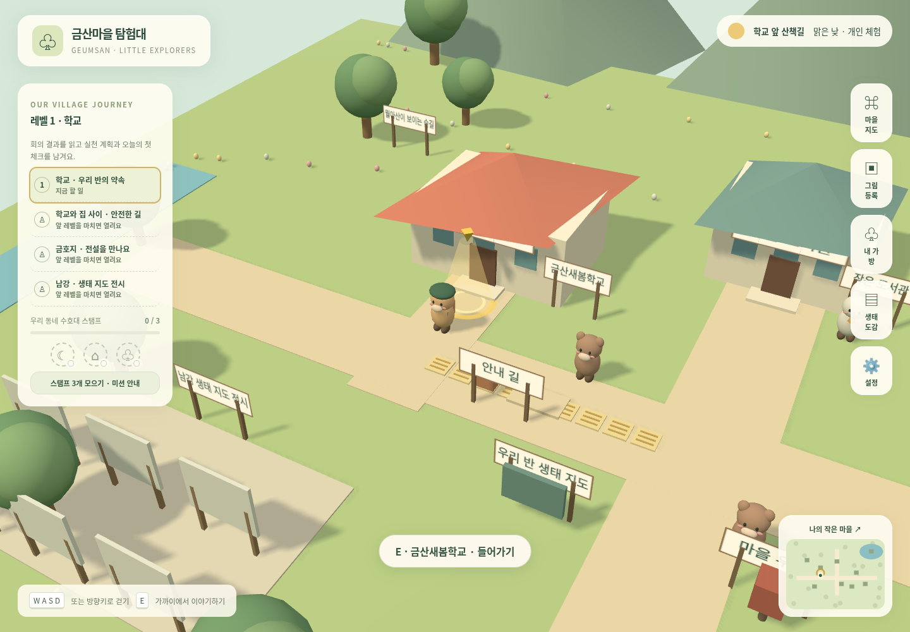

# 금산마을 탐험대 🌱

초등학교 4학년을 위한 브라우저 3D 사회·생태 교육 게임입니다. 주민의 이야기를 듣고, 공동체 문제를 해결하고, 직접 그린 생물을 마을에 등록합니다. 순위 대신 주민의 감사, 활동 배지, 마을 변화로 성취를 표현합니다.



금산면의 장소 이름을 모티브로 만든 수업용 축약 마을입니다. 실제 길 안내가 아니며, 학교·학급 회의·동물 주민은 예시입니다. 가상의 동물 주민이 실제 서식 증거를 의미하지 않습니다.

## 실행

Node.js 22.12 이상(현재 환경: 24.19.0), npm을 사용합니다.

```sh
cd /workspace/Idea-prj-_ver1
npm ci --cache /tmp/geumsan-npm-cache
npm run dev -- --port 5173
```

일반 PC에서는 저장소 폴더로 이동한 뒤 같은 npm 명령을 실행하세요. 브라우저로 개발 서버의 주소를 엽니다. `index.html` 파일 더블클릭 실행은 지원하지 않습니다. 기본 게임·대화·그림 편집에는 API 키와 계정이 필요 없습니다. 설치 뒤 앱 실행에 외부 CDN이 필요하지 않습니다.

```sh
npm run build
npm run preview -- --port 4173
```

정적 호스팅: 빌드 결과 `dist/` 전체를 HTTPS 정적 호스트에 올립니다. Vite의 `base: './'`로 하위 디렉터리 호스팅도 지원합니다. `public/models` 파일은 빌드할 때 `dist/models`로 복사됩니다. 서버 라우팅·백엔드·SPA 경로 재작성은 필요 없습니다. 저장은 사이트 출처(프로토콜·호스트·포트)별이므로 개발 서버와 배포 사이트의 기록은 자동으로 합쳐지지 않습니다. 작품 묶음 또는 개인 백업으로 옮기세요.

## 조작과 수업 순서

- **WASD / 방향키**: 걷기. **E / 가까운 대상 버튼**: 대화·살펴보기·줍기. 한글/영문 상태와 관계없이 물리 키 위치로 처리합니다. 문·주민 가까이에서 화면 아래에 대상 이름이 표시되면 E키 또는 그 버튼을 누르세요. 대상이 없으면 가까이 이동하라는 안내를 표시합니다.
- 터치 기기: 왼쪽 방향 버튼과 화면 아래 상호작용 버튼. 카메라는 고정 방향의 대각선 추적이며 수동 회전이 없습니다.
- 문 가까이에서 학교·도서관에 들어가고 실내 출구로 나옵니다. 실내 게시판/책장 앞에서도 E를 눌러요.
- 대화·퀴즈·그림·입력 창에서는 이동이 멈춥니다. **Esc / ×**로 닫습니다.
- 오른쪽: 마을 지도, 그림 등록, 가방, 생태 도감, 설정. 미니 지도에도 내 위치가 나옵니다.

권장 순서:

1. 시작 위치 뒤 학교 문으로 들어가 게시판의 **예시 회의 결과**를 읽습니다. 안건 → 활동 시작 / 지도 위치.
2. 수달 물결에게 이야기 → 안내 길의 상자 옮기기 → 5칸의 모양·방향 맞추기. 양 끝 점형, 가운데 가로 선형이 이어져야 완료합니다. 실제 시설 수리는 담당 기관의 일입니다.
3. 주택가의 캔·종이·플라스틱병을 가까이서 줍고, 가방에 담긴 물건을 **마을 수거함**에서 분류합니다. 오분류는 재시도하며 처리한 ID는 중복 계산하지 않습니다.
4. 금호지 남생이 느루와 생태 안내원을 만납니다. 호숫가 쓰레기 2개 분류, 쉼터 정리, 행동 구별, 지정된 보라색 **연습 표본** 담기·인계를 완료합니다. 실제 생물을 잡거나 옮기는 활동이 아닙니다.
5. 도서관 책장과 학 사서 다온에게서 자료·퀴즈·작품 도감을 봅니다. 원문 미확인 지역 자료는 교사 검토 전까지 잠겨 있습니다.
6. 우체통 또는 우체부 솔솔 → 편지 작성, 자동 초안 저장, 다시 편집, 미리보기, 게임 속 접수, 텍스트 저장/인쇄. 실제 기관으로 발송하지 않습니다.
7. 학교로 돌아가 문제·해결·생활 실천을 기록합니다.

배지와 퀘스트 완료는 목표 ID로 관리하며 반복 클릭·새로고침·모델 교체로 중복 지급하지 않습니다. 주민 대사와 길·쓰레기·쉼터 모습이 진행 상황에 따라 바뀝니다.

## 그림 등록과 배경 편집

**그림 등록 → 파일 선택 → 회전/자르기 → 배경 지우기 → 지우개/복원 → 기록 작성 → 결과 확인 → 마을 등록** 순서입니다. 파일 선택 창에서 기기가 제공하는 사진 촬영 기능도 사용할 수 있습니다.

- PNG / JPEG / WebP, 파일당 최대 10MB. 헤더로 디코딩 전 크기를 확인하고 4천만 화소를 넘으면 거절합니다. 디코딩 후에도 크기를 확인하며 긴 변은 최대 1024px로 줄입니다.
- 투명 PNG의 알파를 유지합니다. 자동 제거는 선택한 배경색과 비슷하고 **이미지 가장자리와 연결된 영역**만 투명하게 만듭니다. 검은 테두리로 둘러싸인 흰 생물 몸을 보존합니다. 몸이 배경과 이어지면 함께 지워질 수 있으므로 복원 브러시를 사용하세요.
- 배경색·강도·지우개/복원 브러시·크기·되돌리기(8단계)·확대 제공. 자르기는 ‘영역 자르기’ 선택 후 캔버스에서 대각선으로 끕니다. 회전은 시계 방향 90도입니다.
- 복잡한 사진·그림자·가장자리에 닿은 생물은 수동 보정이 필요합니다. 완전히 투명한 결과는 등록하지 않습니다. 결과 확인 체크 후 등록합니다. 모든 처리는 기기 안에서 하며 이미지를 AI 서버로 전송하지 않습니다.
- 생물 이름은 직접 입력합니다. OCR, 사진에서 입체 3D 메시 생성, AI 응답은 구현 범위에 포함되지 않습니다.
- 동물 그림은 허용 서식 구역에서 천천히 움직이고, 식물은 제자리에서 흔들립니다. 그림을 클릭하면 관찰 기록을 봅니다. 설정에서 움직임을 줄일 수 있습니다.
- 이름·별명·설명·관찰 장소·서식 구역을 수정하거나 삭제하면 같은 작품 ID로 마을·지도·도감에 반영됩니다. 3D 표시 최대 30개, 지도·도감은 전체 작품을 표시합니다. 파일 선택 순서가 아닌 ID 저장 순서에 따라 처음 N개를 표시합니다.
- 작품 묶음 JSON은 이미지(base64)와 메타데이터를 함께 담습니다. 동일 ID는 새 항목으로 갱신합니다. 가져오기는 최대 200개/100MB, 그림별 2048px 이하를 확인하고 한 트랜잭션으로 저장합니다. 개인 편지와 소감은 작품 묶음에 포함하지 않습니다.

## 교사용 편집 / 지역 콘텐츠

**설정 → 교사용 수업 편집**에서 편집할 자료를 고릅니다. JSON 편집·검증·저장, 전체 수업 자료 가져오기/내보내기, 예시 되돌리기, 작품 관리를 제공합니다. 로컬 메뉴 구분이며 로그인·실제 교사 권한 보호가 아닙니다.

기본 데이터: `src/data/content.js`. 회의·안건→퀘스트 연결, 대사의 `before/during/after`, 퀴즈의 질문·선택지·정답(0부터)·해설·난이도·장소·출처·검토 상태, 분류 기준과 미션 목표를 수정합니다. 목표 수량은 실제 물건 수와 일치해야 저장됩니다. 배치·쓰레기 변경은 새로고침 뒤 반영합니다. 기존 진행 ID를 바꾸면 해당 연결 기록도 달라지므로 ID를 유지하세요.

**출처의 검토 상태는 사실 검증을 대신하지 않습니다.** 제공된 진주시·한국관광공사·국립생태원·점자블록 법령 원문에 환경 네트워크 정책으로 접근하지 못했습니다. 지역 사실·월아산 유래·금호지 전설·실제 서식·농산물 문항은 `검토 필요`로 숨깁니다. 국립생태원 2025 보고서의 금호지 기록도 직접 PDF를 대조하지 않았으며 현재 개체 수를 추정하지 않았습니다. 교사가 원문을 확인하고 학생용 문장, `sourceTitle/sourceUrl/sourceYear/checkedAt/reviewStatus`를 확정한 뒤 `검토 완료`로 바꾸면 학생 책장과 퀴즈에 노출됩니다. 상황 판단·자료 읽기 퀴즈 25개는 제작 예시로 사용할 수 있습니다. 안내 길 퍼즐은 단순한 직선 학습 예시이며 실제 시공 표준이 아닙니다.

### 주민·장소별 이야기와 퀴즈

`src/data/learning.js`에서 대상별 주제와 추가 예시 문항을 관리합니다. 주민/장소의 퀴즈는 해당 `contexts`에 지정한 문항만 사용하며, 다른 대상의 첫 문제로 대체하지 않습니다.

| context | 대상 | 내용 |
| --- | --- | --- |
| otter | 수달 물결 | 강가 배려·축제 문화·주민 이야기 듣기 |
| turtle | 남생이 느루 | 호수 생물 관찰·먹이 주지 않기·전문가에게 알리기 |
| crane | 학 사서 다온 | 전설과 사실·지명 자료의 근거 |
| house | 주택가 밤톨 | 분리배출·위험한 쓰레기·골목 실천 |
| postman | 우체부 솔솔 | 구체적인 제안·편지 접수의 의미·실천 약속 |
| library | 도서관 책장 | 출처·조사연도·관찰 기록·의견 구분 |
| forest | 숲길 | 새싹 보호·조용한 관찰·관찰과 추측 구분 |
| apartment | 아파트 | 통행로·생활 소음·주민 회의 |
| path | 안내 길 | 점자블록 안전 |

각 주요 주민·장소에 서로 겹치지 않는 기본 퀴즈 3개씩을 마련했습니다. 다음 문제도 같은 주제에서만 고릅니다. 이미 맞힌 문제는 건너뛰고, 해당 주제를 다 풀면 마무리와 선택형 복습 목록을 보여 줍니다. 재방문해도 푼 기록을 유지합니다. 관련 검토 문항이 없으면 “퀴즈 준비 중”을 보여 줍니다. 출처 카드의 퀴즈는 해당 자료 URL에 연결된 검토 문항만 사용합니다.

교사 편집 예: `"contexts": ["postman"]`. 빈 목록은 주민/장소 퀴즈에 노출하지 않습니다. 이전 버전의 브라우저 수업 자료는 최초 한 번 새 연결·예시 문항을 추가합니다. 교사가 바꾼 문장·검토 상태와 기존 작품·편지·활동 기록을 보존합니다. 새 버전에서 교사가 삭제한 예시 문항은 재접속해도 다시 넣지 않습니다. 변경된 원본 이야기와 정확히 같은 기본 문장만 새 기본 이야기로 갱신합니다.

## 모델 연결

`public/models/`에 GLB/glTF를 넣고 `src/data/asset-manifest.json`에서 경로를 설정합니다. GLTFLoader는 Three.js 본체와 동일한 고정 버전 **0.180.0** 패키지에서 가져옵니다. 위치·크기 정규화·방향·바닥 높이·충돌·idle/walk 이름을 역할 ID로 관리합니다. 실패한 모델만 기본 도형으로 남깁니다.

현재 실제 업로드 모델은 없습니다. 파일을 받으면 파일 목록·상대 리소스·실제 크기·방향·문 위치·충돌·클립 이름을 확인해야 합니다. [상세 모델 연결 안내](docs/MODELS.md)를 참고하세요.

## 저장과 공유

- 작품 이미지 **Blob + 정보: IndexedDB** (`geumsan-art-v1`). Object URL을 저장하지 않습니다.
- 퀘스트, 완료 ID, 편지 초안·접수, 소감, 읽은 자료, 설정, 교사 콘텐츠: localStorage.
- 저장 실패는 경고를 표시하고 개인 기록 내보내기를 제공합니다. 그림 저장 실패 시 편집 PNG 저장 버튼도 제공합니다. 다른 탭에서 같은 기록을 동시에 편집하는 충돌 병합은 지원하지 않습니다.
- 작품 묶음은 교사 기기에서 여러 학생 작품을 합칠 수 있습니다. 별도 개인 백업은 편지·소감까지 포함하므로 비공개로 보관하세요.
- **학급 서버 공유·승인·인증·실시간 멀티플레이는 미연결입니다.** [공유 모드 데이터·권한 설계](docs/SHARING.md)에 남은 API와 검증 방법을 기록했습니다.
- 브라우저 사이트 데이터 삭제·시크릿 모드 종료·기기 변경 시 기록이 사라질 수 있으므로 수업 뒤 내보내기를 권장합니다.

## 구조

```text
index.html                 진입점
src/main.js                화면·상호작용·학습 활동 연결
src/world.js               Three.js 마을, 이동·충돌, 모델·작품 렌더링
src/input.js               한글/영문 공통 키 판정·입력란 보호
src/editor.js / image.js    그림 편집 UI / 이미지 처리 함수
src/logic.js               퀘스트 조건·중복 방지·텍스트 처리
src/storage.js             로컬 저장 어댑터와 자료 묶음
src/data/content.js         교체 가능한 학습 자료
src/data/learning.js        대상별 주제·퀴즈 연결·이전 자료 호환
src/data/asset-manifest.json 모델 설정
public/models/             나중에 업로드 모델 배치
```

## 검증

[실시한 검증과 미실시 항목](docs/VALIDATION.md)에 실행 결과를 기록했습니다.

```sh
npm test
npm run test:e2e
npm run build
```

E2E는 Playwright와 Chromium이 필요합니다. 현재 클라우드의 `/usr/bin/chromium`을 사용합니다. 다른 PC는 Playwright Chromium을 설치하거나 `CHROMIUM_PATH`로 실행 파일을 지정하세요. 테스트는 필요한 위치로 플레이어를 배치한 뒤 실제 E키와 UI를 조작합니다. 이동·건물/호수/나무 충돌은 별도로 확인합니다. 전체 동선을 사람이 걸은 검증과 실제 태블릿·실제 업로드 모델 검증을 대체하지 않습니다.

오류 복구: WebGL 실패 시 하드웨어 가속·최신 브라우저 안내, 컨텍스트 소실 시 새로고침 안내, 이미지 형식·용량·읽기 오류 시 재선택 안내, 모델 실패 시 임시 모형, 저장 실패 시 내보내기 안내를 제공합니다. 파일 선택과 편집은 HTML 입력값을 일반 텍스트로 처리합니다.
